# AI-BASED DIABETIC RETINOPATHY DETECTION & MONITORING

**Minor Project – Dissertation (AIML-451)**

**Submitted in partial fulfilment of the requirements for the award of the degree of**

**Bachelor of Technology in Artificial Intelligence and Machine Learning**

**Submitted by**

**Minit Kumar**
**07215611623**

**Under the supervision of**

**Supervisor name to be confirmed**
**Designation to be confirmed**

**Department of Artificial Intelligence and Machine Learning**
**Dr. Akhilesh Das Gupta Institute of Professional Studies**
FC-26, Shastri Park, New Delhi

**November / December 2026**

```{=openxml}
<w:p><w:r><w:br w:type="page"/></w:r></w:p>
```


# DECLARATION

This is to certify that the material embodied in this Minor Project – Dissertation titled **“AI-Based Diabetic Retinopathy Detection & Monitoring”** is based on my original work. It is being submitted in partial fulfilment of the requirements for the award of the degree of Bachelor of Technology in Artificial Intelligence and Machine Learning.

It is further certified that this Minor Project – Dissertation work has not been submitted in full or in part to this university or any other university for the award of any other degree or diploma. My indebtedness to other works has been duly acknowledged at the relevant places.

**Name of the Student:** Minit Kumar
**Enrollment No.:** 07215611623

<br><br>

**Signature of the Student:** ________________________________
**Date:** ____________________
f

```{=openxml}
<w:p><w:r><w:br w:type="page"/></w:r></w:p>
```


# CERTIFICATE

This is to certify that the work embodied in this Minor Project – Dissertation titled **“AI-Based Diabetic Retinopathy Detection & Monitoring”**, submitted in partial fulfilment of the requirements for the award of the degree of Bachelor of Technology in Artificial Intelligence and Machine Learning, is original and has been carried out by **Minit Kumar (07215611623)** under my supervision and guidance.

It is further certified that, to the best of my knowledge and belief, this Minor Project – Dissertation work has not been submitted in full or in part to this university or any other university for the award of any other degree or diploma.

<br><br>

**Faculty Supervisor**
Name: Supervisor name to be confirmed
Designation: Designation to be confirmed
Signature: ________________________________

<br><br>

**Head of Department**
Name: Head of Department name to be confirmed
Department: Artificial Intelligence and Machine Learning
Signature: ________________________________

```{=openxml}
<w:p><w:r><w:br w:type="page"/></w:r></w:p>
```


# ACKNOWLEDGEMENT

I express my sincere gratitude to my faculty supervisor, **Supervisor name to be confirmed**, for guidance, encouragement and technical feedback throughout this project. The discussions on machine learning methodology, model evaluation and software engineering helped shape the work from a notebook experiment into an integrated prototype.

I am grateful to the **Principal name to be confirmed**, the **Head of Department name to be confirmed**, the Department of Artificial Intelligence and Machine Learning and **Dr. Akhilesh Das Gupta Institute of Professional Studies** for providing the academic environment, computing resources and institutional support required to complete the project.

I thank the maintainers of PyTorch, torchvision, timm, FastAPI, OpenCV, Pillow, ReportLab and the other open-source libraries used in the implementation. I acknowledge the APTOS 2019 Blindness Detection dataset and the clinicians and annotators whose work made the supervised learning task possible.

Finally, I thank my classmates, friends and family for their patience and encouragement during dataset preparation, model experimentation, debugging, documentation and report preparation.

<br><br>

**Minit Kumar**

```{=openxml}
<w:p><w:r><w:br w:type="page"/></w:r></w:p>
```


# ABSTRACT

Diabetic retinopathy is a progressive retinal complication of diabetes and a major cause of preventable visual impairment. Screening programs rely on retinal fundus photographs, but manual grading is time-consuming, requires specialist availability and is affected by inter-grader variability. This project presents **RetinaScan AI**, an end-to-end prototype for five-class diabetic retinopathy severity grading using a fine-tuned EfficientNet-B4 model with NoisyStudent pretraining.

The system uses the APTOS 2019 Blindness Detection dataset containing 3,662 labelled training images. Images are processed through black-border removal, Ben Graham illumination correction, contrast enhancement using CLAHE, resizing to 380 × 380 pixels and ImageNet normalisation. A two-stage transfer-learning strategy first trains the classifier head and then fine-tunes the complete network. Focal loss, inverse-frequency class weighting and augmentation are used to reduce the effect of class imbalance. The final model is evaluated on a stratified held-out test set of 550 images using accuracy, Quadratic Weighted Kappa (QWK), per-class precision/recall/F1 and one-vs-rest ROC-AUC.

The recorded test results are **55.6% accuracy**, **0.755 QWK** and **0.901 macro AUC**. The No-DR class reaches an AUC of **0.991**, while the lowest per-class AUC is observed for Severe DR at **0.813**. The prototype also computes Grad-CAM or an explicitly labelled attention fallback, exposes predictions through FastAPI, stores optional patient histories in SQLite and creates PDF, CSV and JSON research artifacts.

The work demonstrates how model development, explainability, backend engineering and longitudinal monitoring can be combined into a reproducible screening-support workflow. The implementation repository is available at **https://github.com/minitttt/AI-Based-Diabetic-Retinopathy-Detection-Monitoring**. It remains a research prototype and requires external validation, calibration, security hardening and clinical governance before any clinical use.

**Keywords:** diabetic retinopathy, fundus photography, EfficientNet-B4, transfer learning, CLAHE, Grad-CAM, FastAPI, patient monitoring, medical AI.

```{=openxml}
<w:p><w:r><w:br w:type="page"/></w:r></w:p>
```


# TABLE OF CONTENTS

```{=openxml}
<w:p><w:r><w:fldChar w:fldCharType="begin" w:dirty="true"/></w:r><w:r><w:instrText xml:space="preserve"> TOC \t &quot;Heading1,1,Heading2,2,Heading3,3&quot; \h \z \u </w:instrText></w:r><w:r><w:fldChar w:fldCharType="separate"/></w:r><w:r><w:fldChar w:fldCharType="end"/></w:r></w:p>
```

```{=openxml}
<w:p><w:r><w:br w:type="page"/></w:r></w:p>
```


# LIST OF FIGURES

```{=openxml}
<w:p><w:r><w:fldChar w:fldCharType="begin" w:dirty="true"/></w:r><w:r><w:instrText xml:space="preserve"> TOC \t &quot;ImageCaption,1&quot; \h \z \u </w:instrText></w:r><w:r><w:fldChar w:fldCharType="separate"/></w:r><w:r><w:fldChar w:fldCharType="end"/></w:r></w:p>
```

```{=openxml}
<w:p><w:r><w:br w:type="page"/></w:r></w:p>
```


# LIST OF TABLES

```{=openxml}
<w:p><w:r><w:fldChar w:fldCharType="begin" w:dirty="true"/></w:r><w:r><w:instrText xml:space="preserve"> TOC \t &quot;TableCaption,1&quot; \h \z \u </w:instrText></w:r><w:r><w:fldChar w:fldCharType="separate"/></w:r><w:r><w:fldChar w:fldCharType="end"/></w:r></w:p>
```

```{=openxml}
<w:p><w:r><w:br w:type="page"/></w:r></w:p>
```


# CHAPTER 1: INTRODUCTION

## 1.1 Background and motivation

Diabetic retinopathy (DR) is a retinal complication associated with diabetes mellitus. It develops when long-term metabolic changes damage the small blood vessels supplying the retina. Early pathological signs may be subtle, and the condition may progress before a person notices a significant change in vision. International clinical grading guidance organises observable disease severity into ordered levels that can be applied to fundus photographs [2]. Automated analysis of retinal photographs has been studied as a way to expand screening capacity and prioritise specialist review [1], [3], [4].

Manual grading is valuable but resource-intensive. Each image must be reviewed for signs such as microaneurysms, retinal haemorrhages, exudates, venous beading and neovascularisation. The task is also ordinal: an error between adjacent grades is not equivalent to an error between No DR and Proliferative DR. This makes the design of the evaluation metric and user interface important.

RetinaScan AI was developed as an academic prototype that explores this workflow from data preparation through deployment. It is not designed to replace a clinical reader. Its purpose is to demonstrate how a model can be trained, evaluated, explained and integrated into a small monitoring application while preserving a clear disclaimer about the limits of automated screening.

```{=openxml}
<w:p><w:r><w:br w:type="page"/></w:r></w:p>
```


## 1.2 Clinical grading context

The project follows the five-level International Clinical Diabetic Retinopathy scale used in the dataset: Grade 0 — No DR; Grade 1 — Mild; Grade 2 — Moderate; Grade 3 — Severe; and Grade 4 — Proliferative [2]. The classes reflect increasing disease severity, but the boundaries between adjacent categories can be difficult even for trained graders.

A machine-learning system should therefore provide more than a single class label. RetinaScan AI returns the predicted grade, the probability distribution over all five grades, an image-quality score and an attention visualisation. These outputs are intended to support review and analysis. The probability vector reveals uncertainty, while the attention image provides a visual clue about the regions that influenced the model. Neither output is a clinical measurement or a substitute for an examination.

The report adopts a cautious interpretation of the model. A high confidence score means that the model's softmax distribution is concentrated; it does not mean that the prediction is calibrated or clinically correct. Similarly, Grad-CAM is treated as an explanation aid rather than as lesion segmentation.

```{=openxml}
<w:p><w:r><w:br w:type="page"/></w:r></w:p>
```


## 1.3 Why an end-to-end prototype is needed

A notebook-only experiment can demonstrate model accuracy but does not show how a user would upload an image, receive a result, revisit a patient record or obtain a report. The project therefore combines four layers: a training and evaluation pipeline, an inference module, a FastAPI service and a browser frontend.

This integration exposes practical issues that are not visible in a standalone model. Uploaded files must be decoded safely. Invalid or non-fundus images should be rejected before inference. Optional patient metadata must be normalised before it is persisted. Generated reports must not expose local filesystem paths. Frontend actions must handle network failures and incomplete metadata. These concerns are part of the project because an AI system is only useful when its model, interface and operational behaviour are coherent.

The result is a small but complete screening-support prototype that can run locally using the included startup script and can be packaged for container deployment.

```{=openxml}
<w:p><w:r><w:br w:type="page"/></w:r></w:p>
```


## 1.4 Project vision and contributions

The project vision is to provide a transparent and extensible foundation for AI-assisted diabetic retinopathy screening research. The principal contributions are:

- A five-class EfficientNet-B4-NS transfer-learning model with 380 × 380 input processing.
- A reproducible preprocessing path combining black-border cropping, Ben Graham illumination correction, CLAHE and ImageNet normalisation.
- A held-out evaluation process reporting accuracy, QWK, class-wise metrics, ROC-AUC and bootstrap confidence intervals.
- Model-attention visualisation with an explicit label for Grad-CAM and fallback methods.
- FastAPI endpoints for inference, patients, scan history and temporary PDF/CSV/JSON artifacts.
- A browser interface for diagnosis, patient monitoring, research exports and model information.

The current evaluation log contains a test set of 550 images, a QWK of 0.755 and a macro AUC of 0.901. These results motivate the prototype but do not establish clinical readiness.

```{=openxml}
<w:p><w:r><w:br w:type="page"/></w:r></w:p>
```


## 1.5 Organisation of the report

Chapter 1 introduces the clinical and technical context. Chapter 2 defines the problem, objectives, scope and stakeholders. Chapter 3 converts the project idea into a software requirements specification and evaluates feasibility. Chapter 4 explains the architecture, data model, interfaces and deployment design.

Chapter 5 documents implementation, beginning with the APTOS dataset and preprocessing and continuing through model training, inference, database persistence, frontend behaviour, report exports, screenshots and source-code excerpts. Chapter 6 describes testing and includes the recorded results and discussion. Chapter 7 presents the summary and conclusion. Chapter 8 records limitations and future work. The final pages provide bibliography and appendix material.

This structure follows the development-based project format supplied with the university dissertation guidelines while retaining research-oriented evaluation evidence.

```{=openxml}
<w:p><w:r><w:br w:type="page"/></w:r></w:p>
```


## 1.6 Introduction close

Diabetic retinopathy screening is an appropriate application for a responsible computer-vision prototype because retinal images contain clinically meaningful visual patterns and the task has an ordinal label structure. The project addresses the problem at both model and system levels. It uses transfer learning to make the image-classification problem tractable, and it wraps the model in a service that can be inspected, tested and used through a browser.

The most important design principle introduced in this chapter is that the system should be treated as screening support rather than autonomous diagnosis. This principle influences the disclaimer, the report layout, the wording used in the frontend and the interpretation of confidence and attention maps. The next chapter translates the motivation into a precise problem statement and a set of measurable objectives.

```{=openxml}
<w:p><w:r><w:br w:type="page"/></w:r></w:p>
```


# CHAPTER 2: PROBLEM STATEMENT

## 2.1 Problem definition

The project addresses the following problem: **given a colour retinal fundus photograph, predict its diabetic retinopathy severity grade on a five-level ordinal scale and make the result available through an interpretable, browser-accessible monitoring workflow.**

The input may vary in brightness, contrast, field-of-view coverage and image quality. The dataset is imbalanced, with No DR cases forming the largest class and Severe DR forming a small minority. The system must therefore combine preprocessing and training decisions that are appropriate for the data distribution. It must also distinguish between a quick analysis that is not saved and a saved scan associated with a patient profile.

The problem has two linked outputs. The first is the model output: class, confidence and probability vector. The second is the software output: a validated API response, optional persistence, an attention image and downloadable research artifacts. Success requires both outputs to be correct and usable.

```{=openxml}
<w:p><w:r><w:br w:type="page"/></w:r></w:p>
```


## 2.2 Objectives

Table 2.1 summarises the project objectives and the corresponding measurable outputs.

Table: Table 2.1: Project objectives and measurable outputs

| Objective | Expected output | Evidence in project |
| --- | --- | --- |
| Train a five-class DR grader | Model that returns grade and probabilities | EfficientNet-B4-NS checkpoint and inference module |
| Reduce image variability | Consistent model input | Cropping, illumination correction, CLAHE and normalisation |
| Evaluate ordinal performance | Accuracy, QWK, AUC and class metrics | Held-out test evaluation logs |
| Provide model transparency | Attention visualisation and disclaimer | Grad-CAM / fallback report fields |
| Support longitudinal review | Patient profiles and scan timeline | SQLite schema and history UI |
| Enable research export | Portable PDF, CSV and JSON artifacts | Report-generation module and endpoints |


The objectives intentionally include system engineering because an isolated model score does not answer how a result will be inspected, stored, exported or revisited.

```{=openxml}
<w:p><w:r><w:br w:type="page"/></w:r></w:p>
```


## 2.3 Scope of the project

The scope includes the following activities:

- Preparation and analysis of the APTOS 2019 labelled fundus-image dataset.
- Implementation of a transfer-learning classifier and a two-stage fine-tuning workflow.
- Evaluation on a stratified held-out test set with visual diagnostics.
- Implementation of a CPU-compatible inference path with optional attention generation.
- Development of a FastAPI backend and static browser frontend.
- Implementation of patient profiles, saved scans, ordinal progression and temporary report artifacts.
- Documentation of limitations, safety boundaries and future production requirements.

The scope does not include regulatory certification, prospective clinical trials, automatic lesion segmentation, ophthalmologist replacement, integration with hospital information systems or a production-grade identity and access-management platform. These exclusions are important because they define what can and cannot be inferred from the current prototype.

```{=openxml}
<w:p><w:r><w:br w:type="page"/></w:r></w:p>
```


## 2.4 Stakeholders and user roles

The primary stakeholder is a clinician or trained screening operator who wants to review a fundus image with an AI-generated screening signal. The interface is designed to keep the original image, predicted grade, probability breakdown, quality score and attention preview visible together. A clinician can optionally select a patient profile and save the scan to a timeline.

The second stakeholder is a researcher or student who needs to inspect model behaviour. Research exports are therefore separated into PDF, CSV and JSON formats. The PDF is designed for human review, CSV supports tabular analysis, and JSON preserves structured metadata such as schema version, model version, image-quality score, explanation method and expiration timestamp.

The project supervisor and evaluator are additional stakeholders. They need evidence that the data was split correctly, that the model was evaluated on held-out data, that requirements were tested and that the interface communicates its limitations. The report and test logs are written to support that review.

```{=openxml}
<w:p><w:r><w:br w:type="page"/></w:r></w:p>
```


## 2.5 Project requirements

The project requirements are grouped into model, application and governance requirements. The model must accept a valid fundus photograph and return five-class probabilities. The application must validate input, provide a stable response contract and keep report resources behind generated identifiers. The monitoring layer must preserve scan ordering and calculate an ordinal baseline-to-latest trend.

The governance requirements are equally important. The system must display a clinical disclaimer, must not present attention maps as lesion segmentation, and must clearly distinguish saved records from quick analyses. It must also avoid claiming that the model is a medical device or that confidence equals certainty.

A project requirement is considered satisfied only when it is visible in the user flow or supported by a reproducible check. For example, the presence of a download button alone is insufficient; the endpoint must produce a readable artifact and the frontend must handle missing or expired metadata.

```{=openxml}
<w:p><w:r><w:br w:type="page"/></w:r></w:p>
```


## 2.6 Requirements conclusion

The project is defined as an ordinal image-classification and monitoring problem rather than only as a neural-network training problem. The required outcome is an end-to-end workflow that is useful for research review: a user uploads a retinal image, the service validates it, the model returns a prediction, the result can be explained and exported, and an optional patient history can be maintained.

The explicit scope boundary protects the project from overclaiming. The prototype demonstrates feasibility and provides a foundation for validation, but it does not make clinical decisions. The following chapter converts these requirements into functional and non-functional specifications and assesses the feasibility of the proposed solution.

```{=openxml}
<w:p><w:r><w:br w:type="page"/></w:r></w:p>
```


# CHAPTER 3: ANALYSIS

## 3.1 Software requirements specification

The software requirements specification describes the behaviour expected from the integrated prototype. The service has three operating modes. In quick-analysis mode, an image is uploaded without a patient identifier and the result is returned without adding a scan to the monitoring database. In saved-scan mode, a valid patient identifier is supplied and the image, metadata and prediction are recorded. In research mode, the user downloads structured artifacts for offline review. The service is implemented with FastAPI and Pydantic validation [21], while the browser interface uses standard HTML, CSS and JavaScript.

The specification also treats failure as part of the normal interface. A malformed image must return a clear client error. An unknown patient must return a not-found response rather than silently creating a new record. A missing report artifact must be presented as unavailable or expired. These behaviours reduce ambiguity and make the prototype easier to evaluate.

The current implementation uses FastAPI route functions, Pydantic validation for patient creation, SQLite persistence and a file-backed reporting module. The frontend uses a single-page layout with three views: Diagnose, History and About.

```{=openxml}
<w:p><w:r><w:br w:type="page"/></w:r></w:p>
```


## 3.2 Literature review and related work

Research on automated DR grading spans clinical decision rules, binary referable-DR detection, multi-class severity grading, ordinal modelling and explainable deep learning. Early clinical systems demonstrated that retinal photographs could be analysed automatically for referable disease [1], while later multi-ethnic validation studies showed the importance of evaluating models across different populations and imaging settings [3].

Deep convolutional networks have become the dominant approach for fundus-image classification. Transfer learning with modern backbones improves representation quality when labelled medical data is limited. EfficientNet provides a parameter-efficient scaling strategy [5], and NoisyStudent pretraining improves the quality of transferred visual features [6]. Earlier DR systems used convolutional models and image-mining strategies to improve screening performance [14], [15], while later systems combined image-quality assessment, lesion detection and grading [16]. For imbalanced datasets, focal loss focuses optimisation on hard examples [7]. Because DR grades are ordered, ordinal-regression methods such as rank-consistent objectives are relevant alternatives to a flat five-class softmax [17].

Public datasets support reproducible research but do not remove the need for external validation. APTOS 2019 provides the labelled data used here [10]. IDRiD includes pixel-level lesion annotations and grading labels [11], while Messidor provides an independent retinal-image benchmark [12]. Broader ophthalmic deep-learning reviews also emphasise technical, clinical and governance considerations [18]. These datasets can support future cross-dataset validation. The current project uses only APTOS and therefore reports its results as an internal held-out evaluation.

Table 3.1 compares representative prior work with the present prototype. The comparison is qualitative because datasets, label definitions, splits and operating points differ. Direct numerical ranking across papers would be misleading.

Table: Table 3.1: Related work comparison

| Work | Task / data | Main contribution | Relevance to this project |
| --- | --- | --- | --- |
| Gulshan et al. [1] | Referable DR from fundus photographs | Large-scale deep-learning screening validation | Motivates automated screening workflow |
| Wilkinson et al. [2] | Clinical DR severity scale | Defines ordered clinical severity categories | Supports five-level label interpretation |
| Ting et al. [3] | Multi-disease retinal screening | External and multi-ethnic evaluation | Motivates future external validation |
| Tan and Le [5] | ImageNet classification | Efficient compound model scaling | Backbone family used here |
| Lin et al. [7] | Dense object classification | Focal loss for hard and imbalanced examples | Loss design used here |
| Cao et al. [17] | Ordinal neural prediction | Rank-consistent ordinal regression | Future alternative to flat softmax |
| RetinaScan AI | APTOS 2019 five-class grading | Model, API, monitoring and report exports | Integrated development prototype |


The gap addressed by this project is integration. Many studies focus on model performance, while a usable screening prototype also needs input validation, quality information, explanations, persistence, reports and a clear boundary between research output and clinical diagnosis.


## 3.3 Functional requirements

Table 3.2 lists the main functional requirements.

Table: Table 3.2: Functional requirements

| ID | Requirement | Acceptance condition |
| --- | --- | --- |
| FR-01 | Upload image | User can select or drag a fundus image into the Diagnose view. |
| FR-02 | Validate image | Unreadable or visually invalid input is rejected with an actionable message. |
| FR-03 | Run inference | Service returns grade, label, confidence and five probabilities. |
| FR-04 | Show explanation | Results view shows attention preview or explains why it is unavailable. |
| FR-05 | Create patient | User can create a profile with generated or supplied patient ID. |
| FR-06 | Save scan | Selected patient, date, eye and notes are persisted with the prediction. |
| FR-07 | View history | User can retrieve scans in chronological order and see trend summary. |
| FR-08 | Export result | PDF, CSV and JSON artifacts can be downloaded from the result panel. |
| FR-09 | Expose metrics | About view presents model architecture and evaluation evidence. |


Each requirement is intentionally phrased in terms of observable behaviour. This permits black-box testing without requiring a reviewer to inspect internal Python objects.

```{=openxml}
<w:p><w:r><w:br w:type="page"/></w:r></w:p>
```


## 3.4 Non-functional requirements

Table 3.3 records non-functional requirements that shape implementation quality.

Table: Table 3.3: Non-functional requirements

| ID | Quality attribute | Project interpretation |
| --- | --- | --- |
| NFR-01 | Usability | Result, confidence, quality and disclaimer should be visible together. |
| NFR-02 | Portability | The backend should run from the repository without depending on the current working directory. |
| NFR-03 | Reproducibility | Dataset split, metrics, model configuration and report schema should be documented. |
| NFR-04 | Safety | Invalid inputs and missing artifacts must fail clearly; no diagnosis claim is permitted. |
| NFR-05 | Maintainability | Backend concerns are separated into inference, utilities, database and reporting modules. |
| NFR-06 | Performance | CPU inference should remain practical for a local demonstration. |
| NFR-07 | Data minimisation | API responses expose generated filenames and relative URLs, not local filesystem paths. |


These requirements are not all fully satisfied for public production deployment. In particular, authentication, rate limiting, durable object storage and external validation remain future work. The distinction between implemented prototype behaviour and production requirements is maintained throughout this report.

```{=openxml}
<w:p><w:r><w:br w:type="page"/></w:r></w:p>
```


## 3.5 Feasibility study

**Technical feasibility.** The selected stack is technically feasible because PyTorch and timm support the EfficientNet-B4-NS architecture, OpenCV and Pillow support image handling, FastAPI provides a small asynchronous web layer and SQLite is sufficient for a local monitoring demonstration. The project already contains state-dict, TorchScript and ONNX export paths, which creates options for later optimisation.

**Operational feasibility.** The browser workflow is understandable to a screening operator: select patient or quick analysis, upload image, review the result and optionally export. The project includes a one-command local startup script that launches the backend and static frontend on documented ports.

**Economic feasibility.** The prototype uses open-source software and can run on commodity hardware, although training EfficientNet-B4 is more practical with GPU access. The cost of a production deployment would be driven by compute, storage, security and clinical validation rather than by software licensing.

**Schedule feasibility.** The work can be divided into data preparation, modelling, evaluation, service implementation, frontend integration, testing and documentation. This staged structure matches the project artefacts present in the repository.

```{=openxml}
<w:p><w:r><w:br w:type="page"/></w:r></w:p>
```


## 3.6 Risk analysis

The most important risks are model bias, class imbalance, distribution shift, invalid image input, persistence of sensitive data and overinterpretation of confidence. The project mitigates some risks using stratified splitting, class-aware training, image validation, an image-quality score, a clinical disclaimer and explicit reporting of per-class metrics.

Other risks remain open. The APTOS dataset is not a complete representation of all cameras, populations and clinical settings. A high AUC on a held-out split does not guarantee performance on another hospital's images. SQLite and local file storage are convenient for a prototype but are not automatically durable or access-controlled in a hosted environment. Attention maps can be visually persuasive even when they are not causally faithful.

The risk analysis therefore treats the prototype as a research instrument. Its main value is to make assumptions and outputs inspectable so that future validation can be performed systematically.

```{=openxml}
<w:p><w:r><w:br w:type="page"/></w:r></w:p>
```


## 3.7 Tools, technologies and platform

Table 3.4 summarises the technology stack.

Table: Table 3.4: Technology stack

| Layer | Technology | Role |
| --- | --- | --- |
| Model training | PyTorch, torchvision, timm | Neural-network definition, optimisation and pretrained backbone |
| Image processing | OpenCV, Pillow, NumPy | Decode, crop, enhancement, quality score and artifact rendering |
| Evaluation | scikit-learn, pandas, matplotlib, seaborn | Metrics, splits, charts and confusion matrices |
| Backend | FastAPI, Uvicorn, Pydantic | REST API, validation and service lifecycle |
| Persistence | SQLite | Patient profiles and scan history |
| Frontend | HTML, CSS, JavaScript | Upload, result, history and about views |
| Reporting | ReportLab, CSV and JSON | Professional PDF and research exports |
| Deployment | Docker, Python HTTP server | Container and local startup paths |


The project deliberately avoids a heavyweight frontend framework because the workflow is small and the static frontend is easy to serve. The backend is modular enough that the same model and database functions can later be placed behind a stronger deployment platform.

```{=openxml}
<w:p><w:r><w:br w:type="page"/></w:r></w:p>
```


## 3.8 Use case analysis

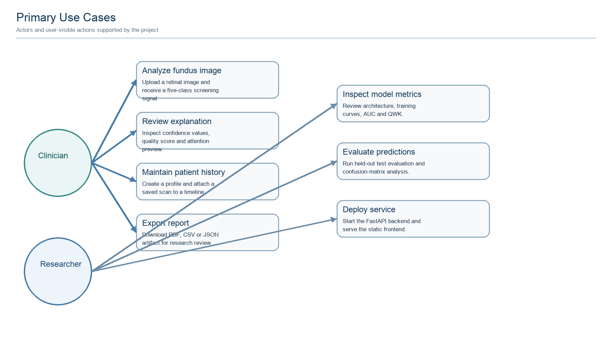

The use-case diagram separates clinician-facing actions from researcher and deployment actions. A clinician begins with an image and may end with a reviewed report or a saved patient-history entry. A researcher may inspect metrics, reproduce evaluation or export structured predictions. The system does not include an autonomous treatment or diagnosis use case; that omission is intentional.

```{=openxml}
<w:p><w:r><w:br w:type="page"/></w:r></w:p>
```


## 3.9 Data-flow analysis

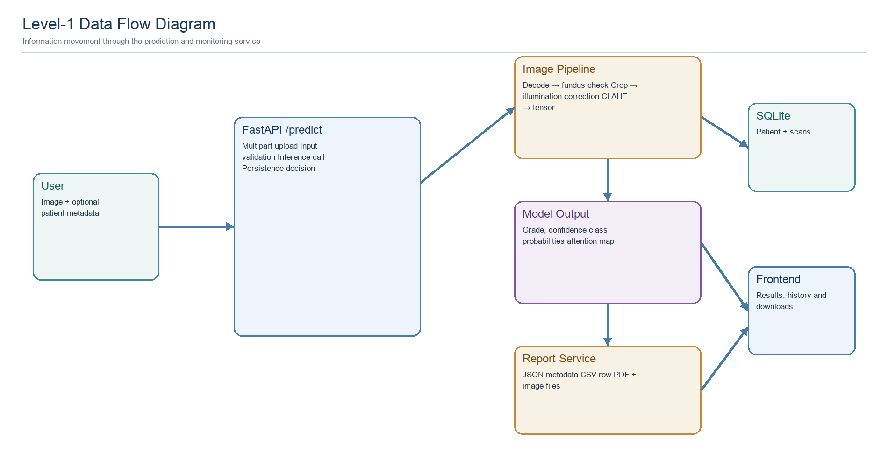

The data-flow analysis shows that the prediction request is the central transaction. It carries an image and optional metadata into validation and preprocessing, then receives model output and report metadata. A saved request additionally writes a scan row and generated image filename to the monitoring store. The report service writes temporary artifacts and exposes only fixed endpoint paths.

The analysis confirms that the planned architecture is feasible and that the main boundary conditions are visible: invalid images, unknown patients, report expiration, storage failures and model availability. The next chapter translates this analysis into an explicit architecture and data design.

```{=openxml}
<w:p><w:r><w:br w:type="page"/></w:r></w:p>
```


# CHAPTER 4: DESIGN AND ARCHITECTURE

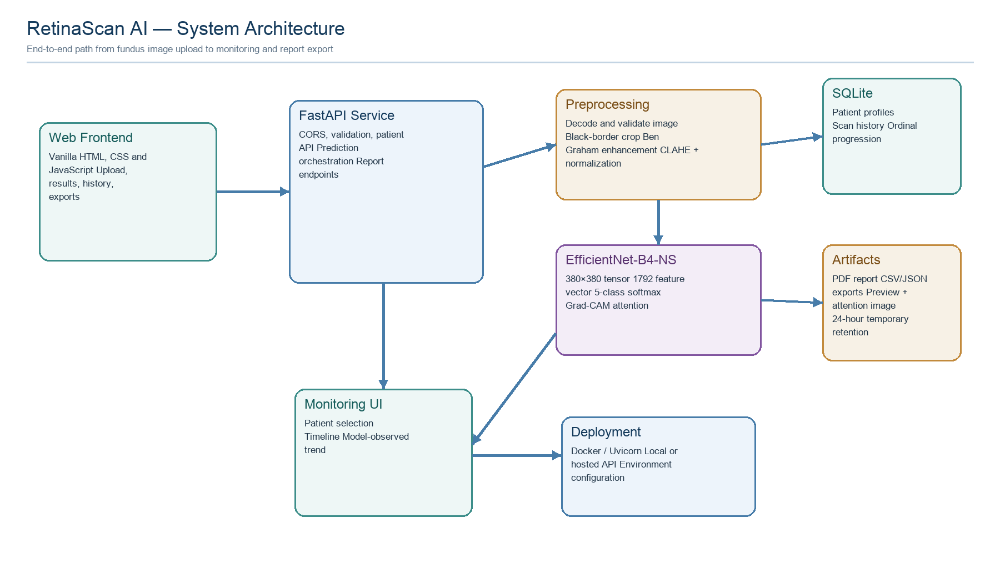

The system is organised as a pipeline with clear responsibilities. The browser handles user interaction and presentation. FastAPI coordinates requests and owns validation at the application boundary. The preprocessing module turns uploaded bytes into a model-ready array and computes the technical image-quality score. The inference module owns the neural network and explanation path. SQLite provides local patient and scan persistence, while the reporting module produces temporary artifacts. This separation supports testing and future replacement of individual components.

```{=openxml}
<w:p><w:r><w:br w:type="page"/></w:r></w:p>
```


## 4.1 Structure chart and work breakdown structure

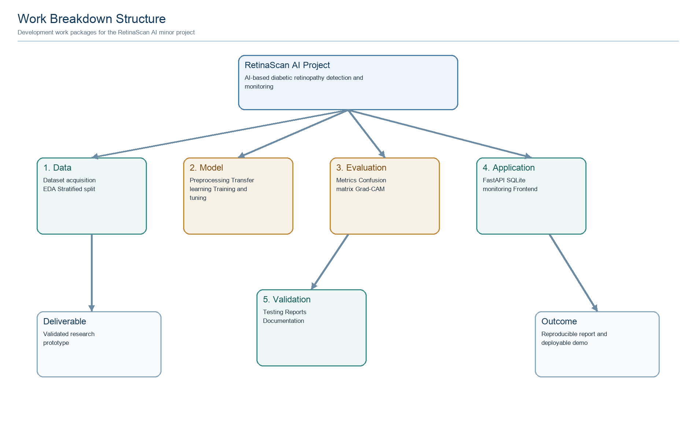

The work breakdown structure divides the project into data, modelling, evaluation, application and validation work packages. This decomposition follows the actual development sequence: dataset preparation creates the input for model development; evaluation verifies the model; application engineering turns the model into a user workflow; and validation joins the evidence into a report and deployment package. The structure also makes responsibilities and deliverables visible for project supervision.

```{=openxml}
<w:p><w:r><w:br w:type="page"/></w:r></w:p>
```


## 4.2 Flow chart and activity diagram

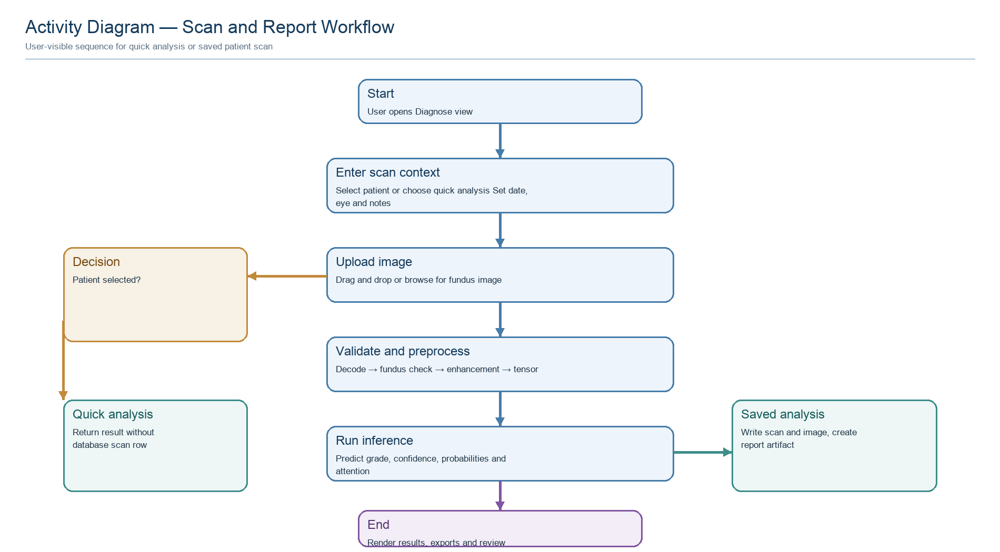

The activity diagram shows the user path from scan-context entry to report generation. The decision branch distinguishes quick analysis from a saved patient scan. Both paths share image validation, preprocessing and model inference, but only the saved path writes a patient-history record and associated image. The final result is rendered in the frontend with the clinical review boundary visible.

```{=openxml}
<w:p><w:r><w:br w:type="page"/></w:r></w:p>
```


## 4.3 Module decomposition

Table 4.1 describes the principal software modules.

Table: Table 4.1: Main software modules

| Module | Primary responsibility | Important interface |
| --- | --- | --- |
| inference.py | Model construction, checkpoint loading, prediction and attention | load_model(), predict_with_explanation() |
| utils.py | Decode, fundus validation, preprocessing and quality score | decode_image(), load_and_preprocess() |
| db.py | SQLite schema, migrations, patient and scan queries | create_patient(), insert_scan(), progression() |
| reporting.py | Temporary artifact generation and safe retrieval | create_report_artifact(), get_report_file() |
| main.py | FastAPI lifecycle, routes, request orchestration | POST /predict, /patients, /reports |
| app.js | Frontend state, navigation, fetch calls and rendering | API_BASE, report and history flows |


The module boundaries are intentionally thin. The route function coordinates the transaction, but image transformation remains in utilities, model behaviour remains in inference and file formats remain in reporting. This helps prevent a future change in PDF layout from changing model logic.

```{=openxml}
<w:p><w:r><w:br w:type="page"/></w:r></w:p>
```


## 4.4 Data model

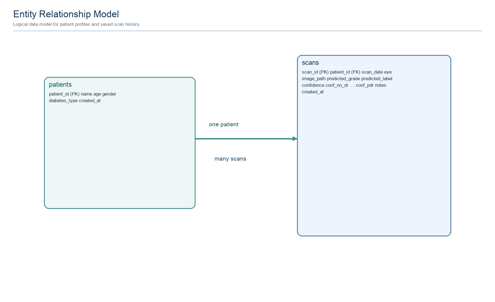

The logical schema uses a one-to-many relationship: one patient may have zero or more saved scans. A patient row contains identity and demographic context supplied by the user. A scan row contains date, eye, image basename, predicted grade, label, confidence, class probabilities and notes. The schema deliberately stores a generated image filename rather than an absolute path in the API response.

The database module applies an additive migration for the eye field so that historical rows remain valid. An index over patient, scan date and scan identifier supports chronological retrieval. The progression function compares the first and latest ordinal predictions and reports stable, improving or worsening model-observed direction.

```{=openxml}
<w:p><w:r><w:br w:type="page"/></w:r></w:p>
```


## 4.5 API design

Table 4.2 lists the core API endpoints.

Table: Table 4.2: Core API endpoints

| Method | Endpoint | Purpose |
| --- | --- | --- |
| GET | / | Basic service response |
| POST | /predict | Validate image, run prediction and create report |
| GET | /patients | List patient profiles and latest summaries |
| POST | /patients | Create patient profile |
| GET | /patients/{id} | Return patient, scans and progression |
| GET | /patients/{id}/scans | Return chronological scans |
| GET | /reports/{id} | Return report metadata |
| GET | /reports/{id}/pdf | Download PDF artifact |
| GET | /reports/{id}/csv | Download CSV artifact |
| GET | /reports/{id}/json | Download JSON artifact |
| GET | /reports/{id}/image | Serve preview image |
| GET | /reports/{id}/attention | Serve attention image |


The /predict response contains both a nested report object and compatibility fields such as report_id and report_urls. This supports the current frontend while keeping the structured report metadata accessible to external research scripts.

```{=openxml}
<w:p><w:r><w:br w:type="page"/></w:r></w:p>
```


## 4.6 Inference data path

The inference path starts with raw bytes. OpenCV decodes the image into RGB format, a fundus-specific heuristic checks dimensions, saturation, contrast and dark border coverage, and the preprocessing pipeline creates the 380 × 380 array. The model applies ImageNet normalisation and produces logits. Softmax converts logits into probabilities, and the maximum probability determines the displayed grade.

The explanation path retains the final spatial feature map when available and computes Grad-CAM for the selected class. If the feature interface is unavailable, the implementation uses a labelled activation, input-gradient or input-intensity fallback. This preserves report availability without misrepresenting the explanation method.

```{=openxml}
<w:p><w:r><w:br w:type="page"/></w:r></w:p>
```


## 4.7 Frontend design

The frontend is a single static document with three primary views. The Diagnose view contains scan context fields, a drag-and-drop upload zone, animated analysis state, prediction card, probability bars, attention preview and export actions. The History view provides patient search, profile creation, saved-scan timeline and progression summary. The About view presents the model architecture, training table, evaluation metrics, confusion matrix and explanatory text.

Accessibility considerations include labelled controls, keyboard focus for the upload zone, a skip link, live status regions for asynchronous actions and descriptive alternative text for images. The interface avoids using colour as the only signal by pairing severity colours with text labels.

Frontend state is kept explicit: the current file, last prediction, last report, scan context and patient state are tracked separately. This reduces accidental reuse of a previous report when a new scan is submitted.

```{=openxml}
<w:p><w:r><w:br w:type="page"/></w:r></w:p>
```


## 4.8 Deployment and privacy design

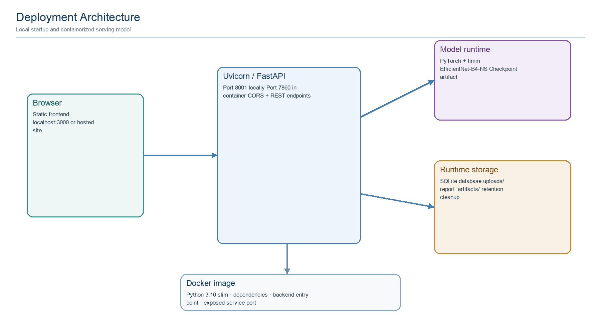

The local deployment uses start.sh to launch Uvicorn on port 8001 and Python's static HTTP server on port 3000. The Dockerfile uses a Python 3.10 slim base image, installs OpenCV-compatible libraries and exposes port 7860 for container hosting. The frontend currently uses a local API base for this workspace; a production deployment should supply the API origin through environment-specific configuration. The implementation uses open-source libraries including PyTorch [13], OpenCV [20], FastAPI [21] and ReportLab [22].

The privacy design is intentionally conservative in wording but remains prototype-level in implementation. Reports and uploads are stored locally and should not receive real patient identifiers in a public demo. Authentication, authorisation, encrypted storage, retention policy enforcement and audit logging are required before clinical deployment.

```{=openxml}
<w:p><w:r><w:br w:type="page"/></w:r></w:p>
```


## 4.9 Temporary artifact design

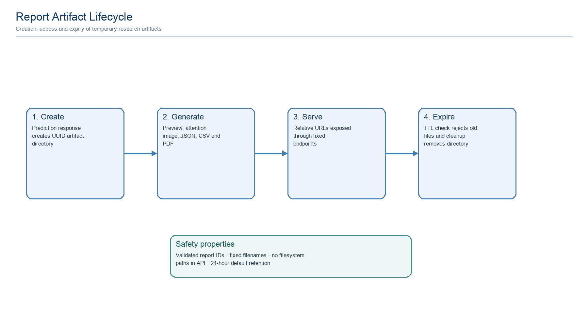

Each analysis receives a random 32-character hexadecimal identifier. The reporting module creates a directory containing report.json, report.csv, report.pdf, preview.jpg and attention.jpg. Public URLs expose only the generated identifier and fixed artifact names. This design avoids accepting arbitrary filesystem paths from the browser.

The architecture is therefore intentionally modular: the image model can be replaced without changing patient queries, and the report renderer can be redesigned without changing inference. The next chapter explains how the design was implemented and how the recorded model evidence was produced.

```{=openxml}
<w:p><w:r><w:br w:type="page"/></w:r></w:p>
```


# CHAPTER 5: IMPLEMENTATION

## 5.1 Dataset and exploratory analysis

The project uses the APTOS 2019 Blindness Detection dataset released through the Kaggle competition resource [10]. The training CSV contains 3,662 records with an image identifier and a diagnosis label from 0 to 4. The image collection contains substantial variation in illumination, camera characteristics, field-of-view coverage and focus quality. These variations make preprocessing and data-quality checks important.

The project notebook records the following class distribution: No DR — 1,805 images (49.3%); Mild — 370 images (10.1%); Moderate — 999 images (27.3%); Severe — 193 images (5.3%); and Proliferative — 295 images (8.1%). The minority classes are clinically important but provide fewer examples for learning. The training design therefore uses stratification, weighted sampling and focal loss.

The exploratory analysis includes representative images by grade and a class-distribution chart. It is used to identify the circular retinal field, black borders, variable illumination and visual differences between labels before model training.

```{=openxml}
<w:p><w:r><w:br w:type="page"/></w:r></w:p>
```


## 5.2 Dataset distribution and split


Table: Table 5.1: Dataset split

| Split | Images | Purpose |
| --- | --- | --- |
| Training | 2,563 | Optimise parameters |
| Validation | 549 | Select and monitor training behaviour |
| Test | 550 | Final held-out evaluation |
| Total | 3,662 | APTOS labelled training set |


The split is stratified and uses a fixed random seed. The first split separates 70% of the records for training and 30% for temporary validation/test data; the latter is divided equally into validation and test sets. The resulting label proportions remain close to the original distribution, which makes the held-out metrics easier to interpret. The test split is not used for model selection.

```{=openxml}
<w:p><w:r><w:br w:type="page"/></w:r></w:p>
```


## 5.3 Representative retinal images

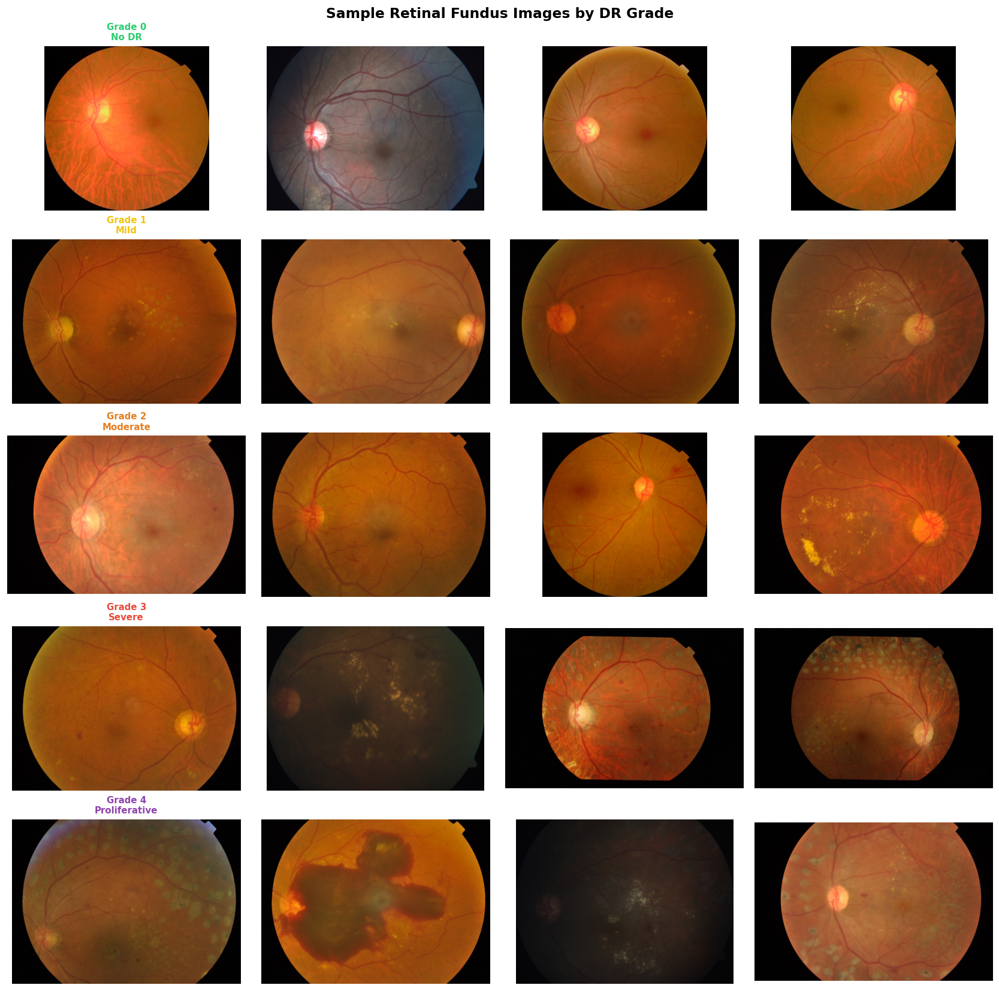

The sample grid illustrates why a purely pixel-level view is insufficient. Images from the same grade can differ in brightness, crop, camera artefact and lesion visibility. Some pathological signs are small relative to the full image, while the black circular border contains no useful retinal information. The project therefore combines spatial standardisation with contrast and illumination processing.

The figure should be interpreted as a qualitative dataset view, not as a diagnostic atlas. Labels originate from the dataset annotations and do not replace a clinical description of each image.

```{=openxml}
<w:p><w:r><w:br w:type="page"/></w:r></w:p>
```


## 5.4 Preprocessing pipeline

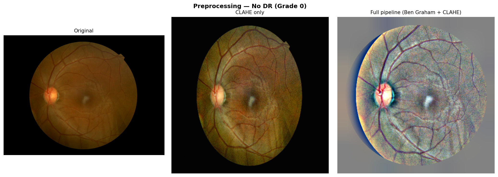

The preprocessing implementation follows four main operations. First, black borders are cropped using a grayscale threshold so the retinal field occupies more of the input. Second, Ben Graham-style Gaussian subtraction reduces uneven illumination and increases local structure. Third, CLAHE is applied channel-wise to improve local contrast; the method was introduced as a contrast-limited extension of adaptive histogram equalisation [19]. Finally, the image is resized to 380 × 380 and converted to a tensor using ImageNet mean and standard deviation.

The order is important. Cropping before resizing avoids using border pixels to determine scale, while contrast processing before normalisation ensures that the network receives a consistent numeric range. The same validation preprocessing is used by the inference service so that deployment input matches the training pipeline.

```{=openxml}
<w:p><w:r><w:br w:type="page"/></w:r></w:p>
```


## 5.5 Augmentation and image-quality score

Training augmentation is designed to expose the model to plausible acquisition variation. The notebook records horizontal and vertical flips, 90-degree rotation, shift/scale/rotation, brightness and contrast changes, hue/saturation/value changes, Gaussian noise and normalisation. Augmentation is applied only to the training path; validation and test images use deterministic transforms.

The deployed service also computes a technical quality score from exposure, contrast, Laplacian sharpness, colour saturation and non-background coverage. The score is scaled to 0–100 and labelled Good, Fair or Needs review. It is explicitly documented as a screening-oriented technical estimate rather than a clinical diagnosis. The quality value is included in the report so that a reviewer can identify low-quality inputs when interpreting a prediction.

The current quality heuristic is intentionally lightweight. It should be calibrated against expert quality grades before being used to reject or triage images in a clinical workflow.

```{=openxml}
<w:p><w:r><w:br w:type="page"/></w:r></w:p>
```


## 5.6 Model architecture

The classifier uses timm's `tf_efficientnet_b4_ns` backbone with the classification head removed and global average pooling enabled. EfficientNet introduced compound model scaling to balance depth, width and resolution [5]. The NoisyStudent pretraining strategy provides the backbone used by this variant [6]. EfficientNet-B4 provides a compound-scaled convolutional representation and 1792 pooled features. A custom head applies dropout with p=0.4, a linear projection from 1792 to 512, GELU activation, BatchNorm1d, dropout with p=0.2 and a final linear layer producing five logits.

The model is suitable for this project because it offers a strong transfer-learning starting point while remaining more compact than large conventional CNNs. The input size of 380 × 380 is higher than the 224-pixel input used by many small image models, which helps preserve fine retinal detail. The trade-off is increased CPU latency and memory use.

The deployment inference module constructs the same architecture with `pretrained=False` and then loads the saved state dictionary. This makes checkpoint availability a critical deployment dependency.

Table: Table 5.2: Model configuration

| Parameter | Value |
| --- | --- |
| Backbone | tf_efficientnet_b4_ns |
| Input resolution | 380 × 380 pixels |
| Feature dimension | 1792 |
| Classifier head | Dropout 0.4 → Linear 1792→512 → GELU → BatchNorm → Dropout 0.2 → Linear 512→5 |
| Output classes | No DR, Mild, Moderate, Severe, Proliferative |
| Optimiser | AdamW |
| Loss | Focal cross-entropy, γ=2, inverse-frequency class weights |
| Batch size | 16 |
| Learning rates | Phase A head: 1×10⁻³; Phase B backbone: 1×10⁻⁴; Phase B head: 1×10⁻³ |
| Weight decay | 1×10⁻⁴ |
| Gradient clipping | Maximum norm 1.0 |
| Primary training metric | Quadratic Weighted Kappa |

```{=openxml}
<w:p><w:r><w:br w:type="page"/></w:r></w:p>
```


## 5.7 Training strategy

Training is implemented in two phases. Phase A freezes the EfficientNet backbone and trains only the custom classifier head for five configured epochs. This allows the new output layer to adapt to the five DR labels without immediately changing all pretrained features. Phase B reloads the best Phase-A checkpoint, unfreezes the backbone and fine-tunes end-to-end using separate learning-rate groups for backbone and classifier. The notebook configures Phase B for up to ten epochs, but the stored history contains four recorded Phase-B epochs; this report does not claim that the full configured budget completed.

The loss is focal cross-entropy with gamma equal to 2 and inverse-frequency class weights. Focal loss down-weights easy examples and concentrates learning on difficult samples [7]. Weighted sampling further reduces the tendency to optimise only for the majority No-DR class. AdamW is used with cosine-based learning-rate schedules, gradient clipping and early stopping based on validation QWK; AdamW decouples weight decay from the gradient update [8]. Phase A uses cosine annealing with a five-epoch schedule and early-stopping patience of three; Phase B uses cosine annealing warm restarts with T₀=5, Tmult=2 and early-stopping patience of five.

The optimisation target is not accuracy alone. QWK is tracked during training because the task is ordinal and distance between grade errors matters. The best checkpoint is selected from validation behaviour and the test set is evaluated only after the training pipeline is complete.

```{=openxml}
<w:p><w:r><w:br w:type="page"/></w:r></w:p>
```


## 5.8 Recorded training curves


Table: Table 5.3: Recorded training history

| Epoch | Phase | Train loss | Val loss | Train QWK | Val QWK | Train acc. | Val acc. |
| --- | --- | --- | --- | --- | --- | --- | --- |
| 1 | Phase A — frozen | 1.092 | 0.371 | 0.417 | 0.578 | 36.2% | 47.4% |
| 2 | Phase A — frozen | 0.741 | 0.336 | 0.485 | 0.614 | 38.4% | 44.4% |
| 3 | Phase A — frozen | 0.665 | 0.300 | 0.491 | 0.612 | 39.8% | 40.3% |
| 4 | Phase A — frozen | 0.638 | 0.299 | 0.448 | 0.616 | 38.5% | 43.9% |
| 5 | Phase A — frozen | 0.604 | 0.297 | 0.503 | 0.652 | 41.1% | 43.5% |
| 6 | Phase B — fine-tuning | 0.633 | 0.304 | 0.557 | 0.666 | 40.7% | 37.3% |
| 7 | Phase B — fine-tuning | 0.462 | 0.279 | 0.677 | 0.689 | 51.5% | 35.3% |
| 8 | Phase B — fine-tuning | 0.371 | 0.300 | 0.713 | 0.658 | 56.5% | 44.6% |
| 9 | Phase B — fine-tuning | 0.308 | 0.242 | 0.751 | 0.701 | 60.4% | 55.0% |


The training history file contains nine recorded epochs. Epochs 1–5 use the frozen-backbone head-training phase; epochs 6–9 use end-to-end fine-tuning. The final recorded epoch has training loss 0.3085, validation loss 0.2424, training QWK 0.7511, validation QWK 0.7007, training accuracy 60.4% and validation accuracy 55.0%. The notebook configures ten Phase-B epochs but records four before the stored run ends, so the table documents recorded evidence rather than an unobserved completion. The notebook uses AdamW, focal loss with γ=2, inverse-frequency class weights, gradient clipping and QWK-based checkpoint selection.

```{=openxml}
<w:p><w:r><w:br w:type="page"/></w:r></w:p>
```


## 5.9 Test evaluation and explainability

The evaluation script loads the best checkpoint and processes every row in `logs/test_split.csv`. For each image it records the true label, predicted label and five probabilities. It then computes a confusion matrix, classification report, QWK, macro one-vs-rest AUC and bootstrap intervals. The output is saved in `logs/evaluation/metrics.json` and `predictions.csv`.

The explanation path uses the model's final spatial feature map when available. Grad-CAM takes the gradient of the selected class logit with respect to the feature map, averages gradients across spatial dimensions to obtain channel weights and produces a non-negative weighted activation map [9]. The map is resized to the source image dimensions and colourised for display.

If a custom timm version does not expose a compatible feature map, the implementation uses a labelled activation, input-gradient or input-intensity fallback. The report includes the method label so that a reviewer can distinguish true Grad-CAM from a fallback visualisation.

```{=openxml}
<w:p><w:r><w:br w:type="page"/></w:r></w:p>
```


## 5.10 Grad-CAM examples

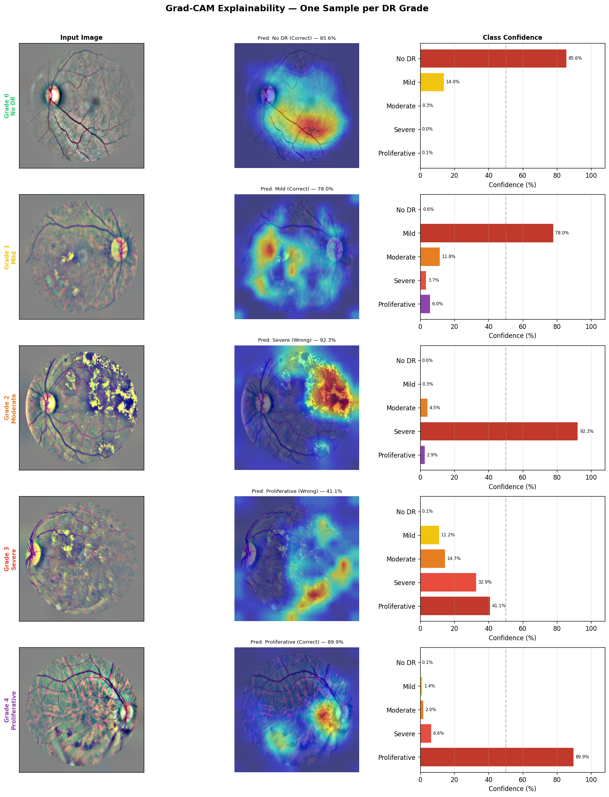

The visualisation grid presents one example per DR grade with the input image, attention overlay and class confidence information. These maps are useful for qualitative auditing: a reviewer can ask whether the highlighted region lies inside the retinal field and whether it appears related to visible structures. They are not proof that the network learned a clinically correct lesion representation.

The report and frontend deliberately use the phrase “attention preview” when the exact explanation method is not known. This avoids presenting a fallback map as a medically validated explanation.

```{=openxml}
<w:p><w:r><w:br w:type="page"/></w:r></w:p>
```


## 5.11 Backend and database implementation

The FastAPI lifespan initialises the SQLite database and loads the model before serving requests. The `/predict` route normalises patient ID, scan date, eye and notes, checks patient existence when persistence is requested, reads the upload, decodes and validates it, computes image quality, runs inference and optionally inserts a scan row. It then creates the report artifact and returns both prediction and report metadata.

The database module anchors its default path to the repository rather than to the current working directory. Environment variables can override the database and upload directories. Additive migration keeps historical scan rows valid when the eye field is introduced. Query functions return JSON-safe dictionaries and strip filesystem paths down to generated basenames.

The implementation uses a transaction context for database operations and deletes an uploaded file if persistence fails. This keeps the local prototype consistent when a write error occurs.

```{=openxml}
<w:p><w:r><w:br w:type="page"/></w:r></w:p>
```


## 5.12 Frontend, reports and deployment integration

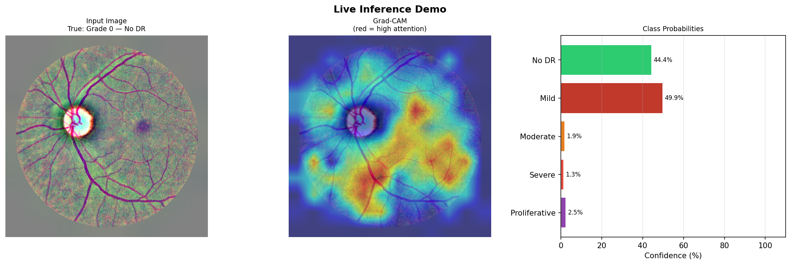

The frontend submits a multipart form containing the selected file and optional scan metadata. On success it renders the image preview, predicted grade, confidence meter, probability bars, report metadata and attention preview. Download handlers fetch the PDF, CSV or JSON resource and create a browser download with a report-specific filename.

The PDF report includes patient and scan metadata, source image, prediction, probability table, model version, quality score, attention image, disclaimer and clinician review fields. The CSV contains one row suitable for research spreadsheets, while JSON preserves nested schema information. The local startup script launches both services, and the Dockerfile provides a container entry point for hosted deployment.

```{=openxml}
<w:p><w:r><w:br w:type="page"/></w:r></w:p>
```


## 5.13 Frontend screenshots and report output

The implementation includes three principal frontend views. The Diagnose view supports image upload and result review; the History view supports patient profiles and longitudinal scans; and the About view presents architecture and evaluation evidence. The sample PDF image shows the generated export that accompanies a prediction.

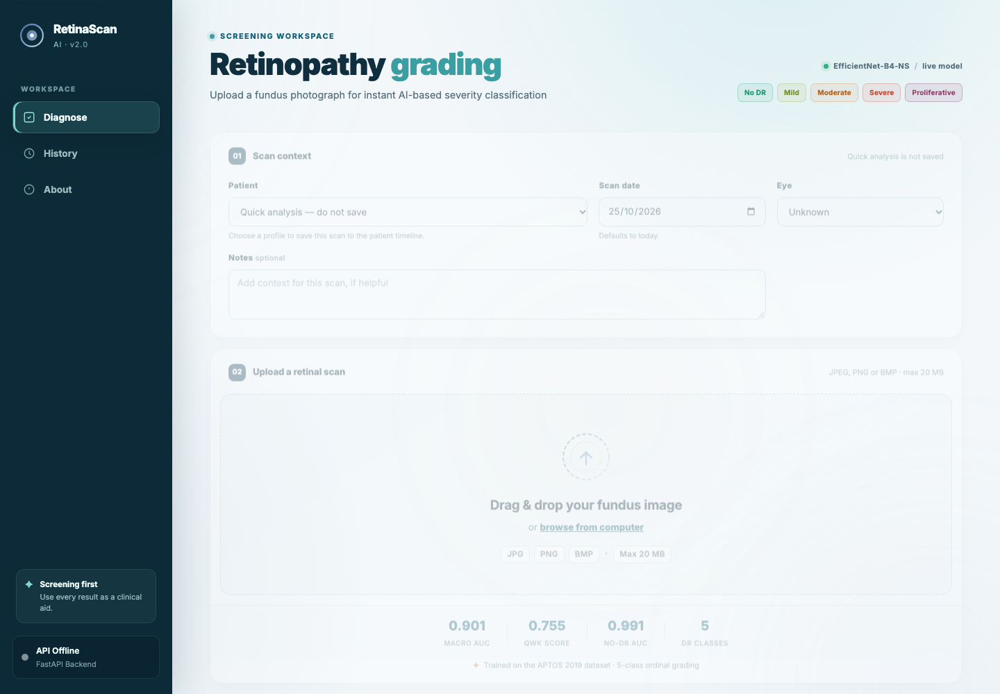

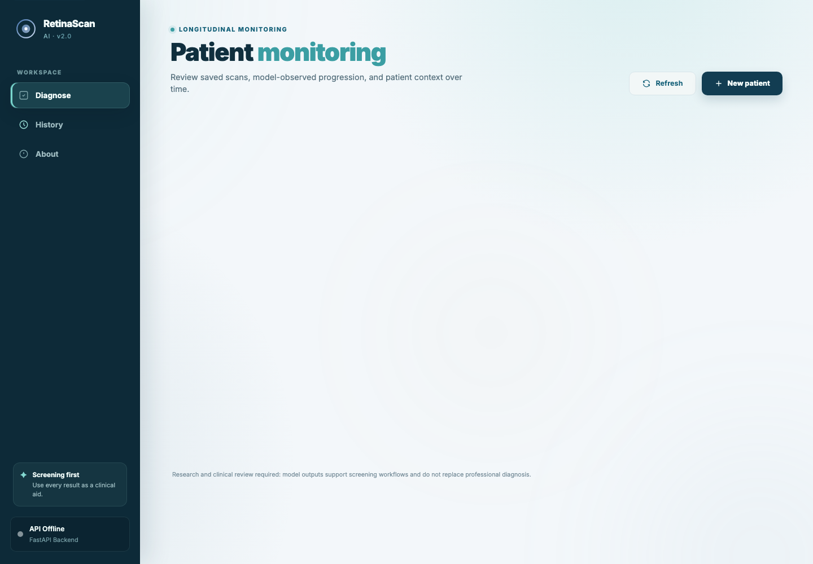


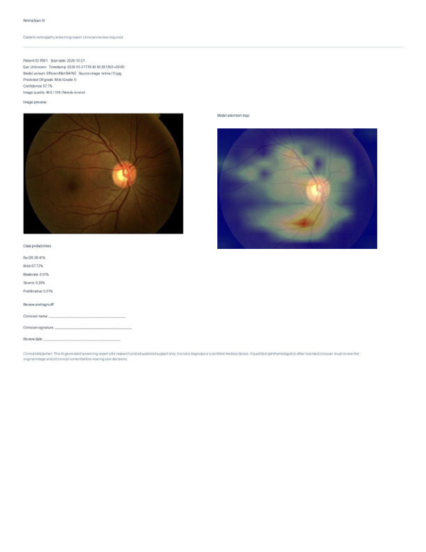


## 5.14 Selected source-code excerpts

The following excerpts document the implementation modules requested by the development-based dissertation format. They are short, representative extracts; the complete source remains in the repository.

**Listing deployment/backend/inference.py, lines 17–37**

```python
0017 | class DRClassifier(nn.Module):
0018 |     def __init__(self, num_classes=NUM_CLASSES, dropout_p=0.4, pretrained=False):
0019 |         super().__init__()
0020 |         self.backbone = timm.create_model(
0021 |             "tf_efficientnet_b4_ns",
0022 |             pretrained=pretrained,
0023 |             num_classes=0,
0024 |             global_pool="avg",
0025 |         )
0026 |         feat_dim = self.backbone.num_features
0027 |         self.classifier = nn.Sequential(
0028 |             nn.Dropout(p=dropout_p),
0029 |             nn.Linear(feat_dim, 512),
0030 |             nn.GELU(),
0031 |             nn.BatchNorm1d(512),
0032 |             nn.Dropout(p=dropout_p / 2),
0033 |             nn.Linear(512, num_classes),
0034 |         )
0035 |
0036 |     def forward(self, x):
0037 |         return self.classifier(self.backbone(x))
```

**Listing deployment/backend/utils.py, lines 108–133**

```python
0108 | def apply_clahe(img, clip_limit=2.0, tile=8):
0109 |     clahe = cv2.createCLAHE(clipLimit=clip_limit, tileGridSize=(tile, tile))
0110 |     return cv2.merge([clahe.apply(ch) for ch in cv2.split(img)])
0111 |
0112 | def ben_graham_preprocess(img, img_size=380):
0113 |     try:
0114 |         img = crop_black_borders(img)
0115 |     except (IndexError, ValueError):
0116 |         pass
0117 |     img = cv2.resize(img, (img_size, img_size))
0118 |     blurred = cv2.GaussianBlur(img, (0, 0), sigmaX=img_size/30)
0119 |     img = cv2.addWeighted(img, 4, blurred, -4, 128)
0120 |     mask = np.zeros_like(img)
0121 |     r = img_size // 2
0122 |     cv2.circle(mask, (r, r), int(r * 0.9), (1, 1, 1), -1)
0123 |     img = img * mask + 128 * (1 - mask)
0124 |     return img.astype(np.uint8)
0125 |
0126 | def load_and_preprocess(img_bytes, img_size=380, use_clahe=True):
0127 |     img = decode_image(img_bytes)
0128 |     if not validate_fundus_image(img):
0129 |         raise ValueError("Please upload a retinal fundus image with the circular retinal field visible.")
0130 |     img = ben_graham_preprocess(img, img_size)
0131 |     if use_clahe:
0132 |         img = apply_clahe(img)
0133 |     return img
```

**Listing deployment/backend/main.py, lines 237–264**

```python
0237 | @app.post("/predict")
0238 | async def predict_image(
0239 |     file: UploadFile = File(...),
0240 |     patient_id: Optional[str] = Form(None),
0241 |     scan_date: Optional[str] = Form(None),
0242 |     eye: Optional[str] = Form(None),
0243 |     notes: Optional[str] = Form(None),
0244 |     save_scan: Optional[str] = Form(None),
0245 | ):
0246 |     """Predict an image, optionally attaching the result to a patient."""
0247 |
0248 |     normalized_patient_id = _normalise_patient_id(patient_id)
0249 |     normalized_date = _normalise_scan_date(scan_date)
0250 |     save_requested = _parse_boolean(
0251 |         save_scan,
0252 |         default=normalized_patient_id is not None,
0253 |     )
0254 |     if normalized_patient_id is not None and not db.patient_exists(normalized_patient_id):
0255 |         raise HTTPException(status_code=404, detail="Patient not found")
0256 |
0257 |     contents = await file.read()
0258 |     try:
0259 |         source_image = decode_image(contents)
0260 |         image_quality_score = compute_image_quality_score(source_image)
0261 |         img_np = load_and_preprocess(contents)
0262 |     except ValueError as exc:
0263 |         raise HTTPException(status_code=400, detail=str(exc)) from exc
0264 |     result, attention_map, explanation_method = predict_with_explanation(img_np)
```

**Listing deployment/backend/reporting.py, lines 627–681**

```python
0627 |     probability_table.setStyle(
0628 |         TableStyle(
0629 |             [
0630 |                 ("BACKGROUND", (0, 0), (-1, 0), colors.HexColor("#123047")),
0631 |                 ("TEXTCOLOR", (0, 0), (-1, 0), colors.white),
0632 |                 ("FONTNAME", (0, 0), (-1, 0), "Helvetica-Bold"),
0633 |                 ("GRID", (0, 0), (-1, -1), 0.25, colors.HexColor("#c9dbe5")),
0634 |                 ("ROWBACKGROUNDS", (0, 1), (-1, -1), [colors.white, colors.HexColor("#f2f7fa")]),
0635 |                 ("ALIGN", (1, 1), (1, -1), "RIGHT"),
0636 |                 ("LEFTPADDING", (0, 0), (-1, -1), 8),
0637 |                 ("RIGHTPADDING", (0, 0), (-1, -1), 8),
0638 |                 ("TOPPADDING", (0, 0), (-1, -1), 5),
0639 |                 ("BOTTOMPADDING", (0, 0), (-1, -1), 5),
0640 |             ]
0641 |         )
0642 |     )
0643 |     story.append(probability_table)
0644 |
0645 |     story.append(Paragraph("Review and sign-off", heading_style))
0646 |     review_table = Table(
0647 |         [
0648 |             [cell("Clinician name", "____________________________________________")],
0649 |             [cell("Clinician signature", "____________________________________________")],
0650 |             [cell("Review date", "____________________")],
0651 |         ],
0652 |         colWidths=[7.3 * inch],
0653 |         hAlign="LEFT",
0654 |     )
0655 |     review_table.setStyle(
0656 |         TableStyle(
0657 |             [
0658 |                 ("BACKGROUND", (0, 0), (-1, -1), colors.HexColor("#f8fbfc")),
0659 |                 ("BOX", (0, 0), (-1, -1), 0.5, colors.HexColor("#c9dbe5")),
0660 |                 ("INNERGRID", (0, 0), (-1, -1), 0.25, colors.HexColor("#d8e5eb")),
0661 |                 ("LEFTPADDING", (0, 0), (-1, -1), 8),
0662 |                 ("RIGHTPADDING", (0, 0), (-1, -1), 8),
0663 |                 ("TOPPADDING", (0, 0), (-1, -1), 7),
0664 |                 ("BOTTOMPADDING", (0, 0), (-1, -1), 7),
0665 |             ]
0666 |         )
0667 |     )
0668 |     story.append(review_table)
0669 |     story.append(Spacer(1, 10))
0670 |     story.append(Paragraph(f"<b>Clinical disclaimer:</b> {_xml(CLINICAL_DISCLAIMER)}", small_style))
0671 |
0672 |     def footer(canvas: Any, document: Any) -> None:
0673 |         canvas.saveState()
0674 |         canvas.setStrokeColor(colors.HexColor("#c9dbe5"))
0675 |         canvas.line(0.55 * inch, 0.42 * inch, 8.0 * inch, 0.42 * inch)
0676 |         canvas.setFont("Helvetica", 7)
0677 |         canvas.setFillColor(colors.HexColor("#557083"))
0678 |         canvas.drawString(0.55 * inch, 0.27 * inch, "RetinaScan AI · AI screening support")
0679 |         canvas.drawRightString(8.0 * inch, 0.27 * inch, f"Page {document.page}")
0680 |         canvas.restoreState()
0681 |
```


# CHAPTER 6: TESTING

## 6.1 Testing strategy

Testing is organised around the user-visible contract rather than around implementation details. The model must produce a five-class response, the service must handle valid and invalid images, patient records must round-trip through SQLite, and report artifacts must be readable. The frontend must not assume that every report contains complete URLs or that every prediction is saved.

The project uses several complementary forms of evidence: syntax and compilation checks, deterministic regression tests, model evaluation on a frozen test split, live API smoke tests performed during development, and inspection of generated PDF/CSV/JSON artifacts. The automated suite currently covers preprocessing, database persistence, report artifacts and report-document structure; the full model-weight evaluation remains a separate evidence-producing script rather than a per-commit test.

The clinical disclaimer is also treated as a testable requirement. A report or interface that shows a grade without communicating the screening-only status would not satisfy the intended safety boundary.

```{=openxml}
<w:p><w:r><w:br w:type="page"/></w:r></w:p>
```


## 6.2 Test environment and test data

Table 6.1 summarises the test environment.

Table: Table 6.1: Test environment and test data

| Area | Environment or source | Purpose |
| --- | --- | --- |
| Python | Project virtual environment / Python 3.x | Backend execution and evaluation scripts |
| Model | EfficientNet-B4-NS checkpoint | Inference and test-set prediction |
| Dataset | APTOS 2019, stratified test split | Held-out metric calculation |
| Backend | FastAPI with Uvicorn | Endpoint and report smoke checks |
| Frontend | Static HTTP server | Browser interaction and download flow |
| Storage | Temporary SQLite and artifact directories | Persistence and lifecycle checks |


Test data should be de-identified. The project uses dataset image identifiers and generated temporary files rather than real patient names. The sample patient records shown in notebook demonstrations are synthetic examples and are not clinical records.

```{=openxml}
<w:p><w:r><w:br w:type="page"/></w:r></w:p>
```


## 6.3 Input validation tests

The image-validation path covers three stages. The byte stream must decode successfully. The decoded array must have three colour channels and a minimum spatial size. The fundus heuristic then checks saturation, contrast and dark-corner coverage so that an arbitrary photograph is less likely to be passed to the classifier.

Representative negative cases include an empty upload, random bytes, a grayscale image, an image smaller than the minimum dimension and an image with no visible circular retinal field. The expected result is a client error with a clear explanation rather than a model prediction. A valid fundus image should proceed to preprocessing and produce a numeric quality score.

The validation heuristic is not a complete image-quality classifier. Its purpose is to prevent obvious misuse and to provide a technical signal. Thresholds should be revisited using a curated quality-labelled dataset before deployment beyond research use.

```{=openxml}
<w:p><w:r><w:br w:type="page"/></w:r></w:p>
```


## 6.4 Model and evaluation tests

The frozen evaluation script provides the strongest model-level regression evidence currently stored in the repository. It loads `logs/test_split.csv`, runs deterministic preprocessing and records prediction vectors for all 550 rows. The test output is checked for the expected number of rows, five probabilities per row and finite metric values.

The primary checks are that the confusion matrix has five rows and columns, that the probability vector sums approximately to one, that QWK is computed with quadratic weights and that one-vs-rest AUC is computed for each class. Bootstrap intervals are generated using a fixed random seed so that the reported range is repeatable for the same predictions.

The current regression suite protects preprocessing, persistence, report normalisation, path safety and document structure. A further model-level regression could compare a checkpoint checksum and a small set of reference predictions; that would detect unintended checkpoint or preprocessing changes without requiring the entire 550-image evaluation on every commit.

```{=openxml}
<w:p><w:r><w:br w:type="page"/></w:r></w:p>
```


## 6.5 API integration tests

API integration tests follow the real sequence a user experiences. First, the service is started and the root endpoint is checked. A patient profile is created and read back. A valid image is posted with no patient identifier to exercise quick analysis. The same or another valid image is posted with a patient identifier to verify persistence. The patient endpoint is then queried to confirm that the scan appears in chronological history.

The report URLs returned from `/predict` are fetched independently. PDF content type and non-zero size are checked; CSV is parsed as a one-row table; JSON is decoded and checked for schema version, model, prediction and expiry fields; preview and attention images are decoded as JPEG. This sequence verifies that a visible button is connected to a real artifact.

Errors are checked using an unknown patient identifier, invalid scan date, invalid save flag and malformed image. Each error should be a controlled HTTP response rather than an unhandled traceback.

```{=openxml}
<w:p><w:r><w:br w:type="page"/></w:r></w:p>
```


## 6.6 Report-artifact tests

Report generation is tested as a multi-file transaction. A report directory is created using a generated identifier. The JSON payload is written first as the source of structured metadata, the CSV row is derived from the same normalised prediction and the PDF embeds the preview and attention images. If any stage fails, the artifact directory is removed so that partial reports are not served.

The artifact ID accepts only 32 lowercase hexadecimal characters. The endpoint maps a small fixed set of kinds to fixed filenames, which blocks path traversal through the report identifier or kind parameter. Public metadata contains relative URLs and never exposes the absolute directory. These properties are important because the report may contain a patient identifier and uploaded image.

Expiry is part of the artifact contract. The default retention value is 24 hours and can be configured for testing or deployment. The regression suite sets a short test TTL and verifies that expired metadata and artifact paths are removed or rejected.

```{=openxml}
<w:p><w:r><w:br w:type="page"/></w:r></w:p>
```


## 6.7 Negative and failure-path testing

Failure-path testing is especially important for an AI service because the most dangerous failure is a plausible-looking result produced for invalid input. The project therefore distinguishes input rejection from model uncertainty. An image that fails the fundus check is rejected. An accepted image may still receive a low-confidence prediction and should remain labelled as a screening signal.

Storage failures are handled by removing the generated upload if the database insert fails. Report-generation failures are returned as a server error; the saved scan remains intact and can be investigated. Missing or expired artifacts return a 404 response rather than a server path or a stale file.

These behaviours do not provide complete operational resilience. Authentication, rate limiting, structured logging, monitoring and backup recovery remain necessary for a hosted service.

```{=openxml}
<w:p><w:r><w:br w:type="page"/></w:r></w:p>
```


## 6.8 Representative test cases

Table: Table 6.2: Representative test cases

| Test ID | Scenario | Expected result | Observed result |
| --- | --- | --- | --- |
| TC-01 | Valid fundus, quick analysis | 200 response with five probabilities and report ID | Passed — live smoke check |
| TC-02 | Valid fundus, saved patient scan | Scan appears in patient history | Passed — live smoke check |
| TC-03 | Random bytes upload | 400 readable-image error | Passed — utility regression test |
| TC-04 | Unknown patient ID | 404 Patient not found | Passed — route validation |
| TC-05 | Invalid scan date | 400 ISO-date error | Passed — route validation |
| TC-06 | PDF download | Non-empty application/pdf artifact | Passed — artifact regression test |
| TC-07 | CSV download | One data row with probability columns | Passed — artifact regression test |
| TC-08 | JSON download | Decodable schema-versioned payload | Passed — artifact regression test |
| TC-09 | Attention preview | JPEG image or explicit fallback message | Passed — artifact regression test |
| TC-10 | Invalid report ID | 404 without filesystem disclosure | Passed — path regression test |


The test suite combines deterministic unit tests for preprocessing, database and report behaviour with live endpoint smoke checks for the integrated prediction flow.

```{=openxml}
<w:p><w:r><w:br w:type="page"/></w:r></w:p>
```


## 6.9 Testing summary and performance considerations

The project has evidence for model evaluation, report generation and the main local user flow. The regression suite covers preprocessing, database persistence, report normalisation, path safety and report-document structure. The recorded run of `python3 -m pytest -q` produced **10 passed and 5 skipped** tests; the skipped cases correspond to optional OpenCV-dependent checks in the system Python environment. Additional live checks cover the prediction and export sequence. The checks are intentionally separated from the model-weight evaluation so that documentation and application regressions can be detected quickly.

EfficientNet-B4 at 380 × 380 is computationally heavier than a small mobile model. CPU inference is acceptable for a demonstration but may be too slow for high-throughput screening. The current service loads the model during application startup, which avoids reloading per request but increases startup time and memory use. Future measurements should report warm and cold latency, peak memory, concurrent request behaviour and attention-generation overhead separately.

The chapter demonstrates that the system can be tested at input, model, API, artifact and interface boundaries. The next chapter analyses the recorded results and their meaning.

```{=openxml}
<w:p><w:r><w:br w:type="page"/></w:r></w:p>
```


## 6.10 Results and discussion

### 6.10.1 Results overview

The project reports results at three levels. Training results describe optimisation behaviour across the recorded run. Test-set results describe generalisation on the held-out APTOS split. System results describe whether a prediction can be transformed into a usable report and monitoring record.

The model achieves a test accuracy of 55.6%, a QWK of 0.755 and macro one-vs-rest AUC of 0.901 on 550 held-out images. These values should be read together. Accuracy treats every class error equally, whereas QWK gives more weight to distant ordinal mistakes. AUC measures ranking quality and is not equivalent to sensitivity at a deployment threshold.

The system result is qualitative but important: a prediction includes structured probabilities, attention method, image-quality score and downloadable artifacts. This makes the model output inspectable rather than reducing it to a single coloured label.

```{=openxml}
<w:p><w:r><w:br w:type="page"/></w:r></w:p>
```


### 6.10.2 Training results

Table: Table 6.3: Recorded training history

| Recorded epoch | Train loss | Val loss | Train QWK | Val QWK | Train acc. | Val acc. |
| --- | --- | --- | --- | --- | --- | --- |
| 1 | 1.092 | 0.371 | 0.417 | 0.578 | 36.2% | 47.4% |
| 2 | 0.741 | 0.336 | 0.485 | 0.614 | 38.4% | 44.4% |
| 3 | 0.665 | 0.300 | 0.491 | 0.612 | 39.8% | 40.3% |
| 4 | 0.638 | 0.299 | 0.448 | 0.616 | 38.5% | 43.9% |
| 5 | 0.604 | 0.297 | 0.503 | 0.652 | 41.1% | 43.5% |
| 6 | 0.633 | 0.304 | 0.557 | 0.666 | 40.7% | 37.3% |
| 7 | 0.462 | 0.279 | 0.677 | 0.689 | 51.5% | 35.3% |
| 8 | 0.371 | 0.300 | 0.713 | 0.658 | 56.5% | 44.6% |
| 9 | 0.308 | 0.242 | 0.751 | 0.701 | 60.4% | 55.0% |


Training loss decreases from 1.092 to 0.308 across the recorded rows. Validation loss reaches its minimum recorded value of 0.242. Training QWK rises to 0.751 and validation QWK reaches 0.701. The gap between training and validation behaviour indicates that the model learns useful ordinal structure but still faces generalisation difficulty, especially for minority and adjacent grades.

```{=openxml}
<w:p><w:r><w:br w:type="page"/></w:r></w:p>
```


### 6.10.3 Summary test metrics

Table: Table 6.4: Summary evaluation metrics

| Metric | Value | Interpretation |
| --- | --- | --- |
| Test size | 550 | Held-out images |
| Accuracy | 55.6% | Exact grade agreement |
| Quadratic Weighted Kappa | 0.755 | Ordinal agreement measure |
| Macro AUC | 0.901 | Mean one-vs-rest ranking performance |
| QWK bootstrap 95% interval | 0.710–0.796 | Resampling uncertainty estimate |
| Macro AUC bootstrap 95% interval | 0.880–0.920 | Resampling uncertainty estimate |


The QWK interval is reasonably concentrated around the point estimate for this split, but it should not be interpreted as external validation uncertainty. Bootstrap resampling reflects variation within the available test set; it does not account for a new camera, site or patient population.

```{=openxml}
<w:p><w:r><w:br w:type="page"/></w:r></w:p>
```


### 6.10.4 Class-wise precision, recall and F1

Table: Table 6.5: Class-wise precision, recall and F1

| Class | Precision | Recall | F1-score | Support |
| --- | --- | --- | --- | --- |
| No DR | 0.995 | 0.753 | 0.857 | 271 |
| Mild | 0.302 | 0.875 | 0.450 | 56 |
| Moderate | 0.889 | 0.053 | 0.101 | 150 |
| Severe | 0.141 | 0.414 | 0.211 | 29 |
| Proliferative | 0.371 | 0.750 | 0.496 | 44 |


The class-wise table reveals a central limitation hidden by the macro AUC. Moderate recall is only 0.053 even though Moderate AUC is 0.910. This means the model can rank Moderate images reasonably well across thresholds but the default argmax decision rule often selects a neighbouring or higher grade. Severe precision is also low, reflecting overprediction of Severe for some Moderate cases. These patterns support the use of calibration, ordinal decision rules and threshold analysis in future work.

```{=openxml}
<w:p><w:r><w:br w:type="page"/></w:r></w:p>
```


### 6.10.5 Per-class AUC analysis

Table: Table 6.6: Per-class AUC

| Class | AUC | Observation |
| --- | --- | --- |
| No DR | 0.991 | Strong separation of healthy and non-healthy cases in this split |
| Mild | 0.882 | Useful ranking but affected by class overlap |
| Moderate | 0.910 | High ranking score despite weak argmax recall |
| Severe | 0.813 | Lowest AUC; minority and visually overlapping class |
| Proliferative | 0.906 | Strong ranking relative to the available support |


AUC is useful because it separates ranking quality from one operating threshold. For screening design, the next step would be to define clinically meaningful binary tasks, such as any DR versus No DR or referable DR versus non-referable DR, and measure sensitivity and specificity at chosen thresholds. The current five-class AUC table is evidence for research comparison, not a deployment threshold recommendation.

```{=openxml}
<w:p><w:r><w:br w:type="page"/></w:r></w:p>
```


### 6.10.6 Confusion matrix interpretation

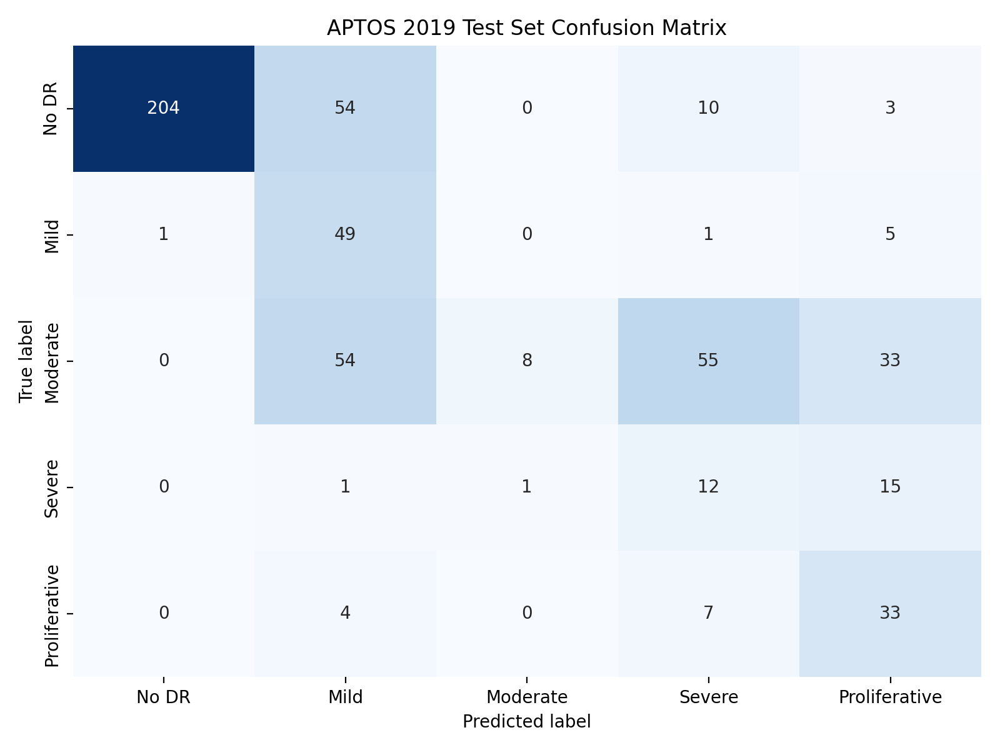

The raw confusion matrix contains 204 correct No-DR predictions, 49 correct Mild predictions, 8 correct Moderate predictions, 12 correct Severe predictions and 33 correct Proliferative predictions. No-DR precision is high because very few non-No-DR images are predicted as No DR. Moderate cases are distributed across Mild, Severe and Proliferative predictions, which explains the low Moderate recall and illustrates the difficulty of using a flat argmax rule for an ordinal task.

The matrix also shows why QWK is informative: many mistakes remain close to the diagonal, but the clinical meaning of a Moderate-to-Mild error differs from a No-DR-to-Proliferative error. A future ordinal model could optimise a distance-aware loss directly.

```{=openxml}
<w:p><w:r><w:br w:type="page"/></w:r></w:p>
```


### 6.10.7 ROC curves and explainability

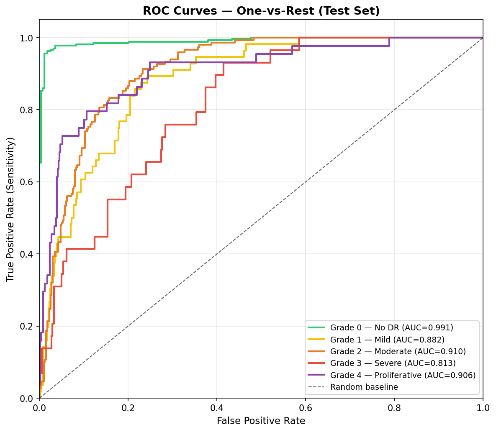

The ROC curves provide a threshold-independent view of the five class scores. No DR reaches an AUC of 0.991, the strongest class separation in the experiment. Severe reaches 0.813, the lowest value, which is consistent with its smaller support and overlap with Moderate and Proliferative patterns.

The explanation images should be reviewed alongside these quantitative results. A high AUC does not guarantee that attention is clinically meaningful, and a visually plausible heatmap does not prove high accuracy. Combining probability, quality and attention information gives the reviewer a richer but still imperfect basis for inspection.

```{=openxml}
<w:p><w:r><w:br w:type="page"/></w:r></w:p>
```


### 6.10.8 Monitoring workflow and threats to validity

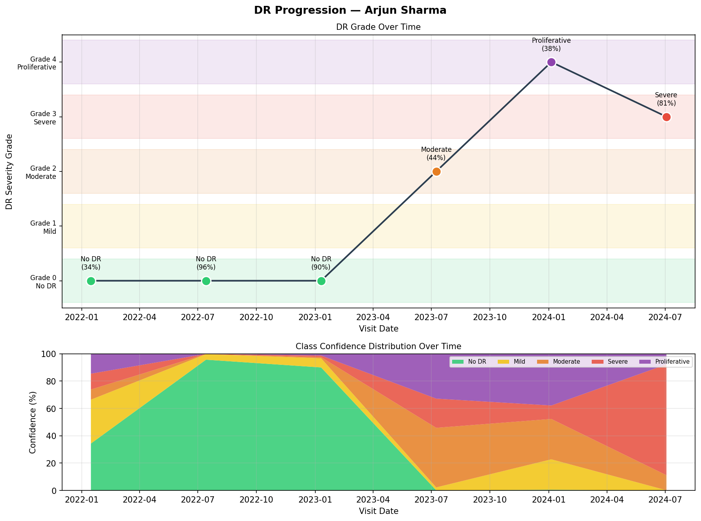

The monitoring module stores a sequence of saved predictions and compares the baseline grade with the latest grade. The notebook demonstration uses synthetic patient profiles and six example visits to show how a timeline can display stable, improving or worsening model-observed direction. This is a software demonstration, not longitudinal clinical evidence.

Threats to validity include label noise, class imbalance, dataset shift, lack of external validation, possible leakage through image-level rather than patient-level splitting, and the fact that the final service checkpoint must be available and verified before deployment. The results support continued research but do not establish safety, calibration or clinical effectiveness.

```{=openxml}
<w:p><w:r><w:br w:type="page"/></w:r></w:p>
```


# CHAPTER 7: SUMMARY AND CONCLUSION

## 7.1 Summary and conclusion

This project developed an integrated prototype for AI-based diabetic retinopathy detection and monitoring. The model uses EfficientNet-B4-NS transfer learning, a five-class classifier head, focal loss, inverse-frequency weighting and a stratified APTOS 2019 split. Preprocessing combines border cropping, illumination correction, CLAHE, resizing and normalisation.

The system provides more than model inference. It validates uploaded images, reports technical quality, creates Grad-CAM or labelled fallback attention, exposes REST endpoints, stores optional patient histories, calculates ordinal progression and generates PDF, CSV and JSON exports. The browser frontend presents the workflow in Diagnose, History and About views.

The evaluation logs report 55.6% test accuracy, 0.755 QWK and 0.901 macro AUC on 550 held-out images. These results show useful signal but also reveal class-wise weaknesses, particularly for Moderate and Severe argmax decisions. The project therefore succeeds as a research and engineering prototype while leaving clinical validation as future work.

```{=openxml}
<w:p><w:r><w:br w:type="page"/></w:r></w:p>
```


# CHAPTER 8: LIMITATIONS AND FUTURE WORK

## 8.1 Limitations

Table: Table 8.1: Limitations and mitigation direction

| Limitation | Effect | Mitigation direction |
| --- | --- | --- |
| Single public dataset | Unknown generalisation to other sites | External multi-centre validation |
| Class imbalance | Weak minority-class precision/recall trade-offs | More data, calibrated thresholds, ordinal loss |
| Argmax output | Moderate cases often move to adjacent classes | Cost-sensitive decision policy |
| Local storage | Data may be lost or exposed in hosted environments | Managed database and object storage |
| No authentication | Patient history is not safe for public deployment | Identity, authorization and audit logging |
| Heuristic quality score | Not clinically validated | Expert-labelled quality study |
| Attention maps | Not lesion segmentation or causal proof | Faithfulness and reader studies |
| Checkpoint dependency | Missing weights can invalidate inference | Verified artifact, checksum and readiness gate |


The limitations are not minor implementation details. Each one can change the meaning of a result. The prototype should therefore be used only with synthetic or properly governed research data and with qualified human review.

## 8.2 Future work

Future work should proceed in phases. First, harden the service with explicit environment configuration, a readiness endpoint, upload limits, restricted CORS, report-expiration enforcement, `.dockerignore` rules and automated regression tests. Second, improve the model with ordinal objectives, calibration, threshold selection and external datasets. Third, improve clinical relevance through quality-labelled data, reader comparison and subgroup analysis. Fourth, improve deployment with authentication, PostgreSQL, object storage, backups, monitoring and audit trails.

Model development could compare EfficientNet-B4 with smaller backbones and exported ONNX/TorchScript runtimes. The prediction interface could expose binary screening tasks alongside the five-class output. Report generation could accept clinician review fields and preserve a signed review record. A future study should measure latency, memory and concurrency under a defined workload rather than relying on informal “real-time” wording.

The long-term goal is not to make the model autonomous. It is to build a validated decision-support system in which the model, image quality, explanation, clinical reviewer and governance process are all visible.

```{=openxml}
<w:p><w:r><w:br w:type="page"/></w:r></w:p>
```


# BIBLIOGRAPHY AND APPENDIX

## Bibliography

[1] V. Gulshan *et al.*, “Development and Validation of a Deep Learning Algorithm for Detection of Diabetic Retinopathy in Retinal Fundus Photographs,” *JAMA*, vol. 316, no. 22, pp. 2402–2410, 2016.

[2] C. Wilkinson *et al.*, “Proposed international clinical diabetic retinopathy and diabetic macular edema disease severity scales,” *Ophthalmology*, vol. 110, no. 9, pp. 1677–1682, 2003.

[3] D. S. W. Ting *et al.*, “Development and validation of a deep learning system for diabetic retinopathy and related eye diseases using retinal images from multiethnic populations with diabetes,” *JAMA*, vol. 318, no. 22, pp. 2211–2223, 2017.

[4] M. D. Abràmoff *et al.*, “Improved automated detection of diabetic retinopathy on a publicly available dataset through integration of deep learning,” *Investigative Ophthalmology & Visual Science*, vol. 57, no. 13, pp. 5200–5206, 2016.

[5] M. Tan and Q. V. Le, “EfficientNet: Rethinking model scaling for convolutional neural networks,” in *Proc. 36th Int. Conf. Machine Learning*, 2019, pp. 6105–6114.

[6] Q. Xie *et al.*, “Self-training with noisy student improves ImageNet classification,” in *Proc. IEEE/CVF Conf. Computer Vision and Pattern Recognition*, 2020, pp. 10687–10698.

[7] T.-Y. Lin *et al.*, “Focal loss for dense object detection,” in *Proc. IEEE International Conference on Computer Vision*, 2017, pp. 2980–2988.

[8] I. Loshchilov and F. Hutter, “Decoupled weight decay regularization,” in *Proc. International Conference on Learning Representations*, 2019.

[9] R. R. Selvaraju *et al.*, “Grad-CAM: Visual explanations from deep networks via gradient-based localization,” in *Proc. IEEE International Conference on Computer Vision*, 2017, pp. 618–626.

[10] Kaggle, “APTOS 2019 Blindness Detection,” dataset and competition resource, 2019. [Online]. Available: https://www.kaggle.com/c/aptos2019-blindness-detection. [Accessed: Oct. 25, 2026].

[11] P. Porwal *et al.*, “Indian diabetic retinopathy image dataset (IDRiD): a database for diabetic retinopathy screening research,” *Data*, vol. 3, no. 3, art. no. 25, 2018, doi: 10.3390/data3030025.

[12] E. Decencière *et al.*, “Feedback on a publicly distributed image database: the Messidor database,” *Image Analysis & Stereology*, vol. 33, no. 3, pp. 231–234, 2014, doi: 10.5566/ias.1155.

[13] A. Paszke *et al.*, “PyTorch: An imperative style, high-performance deep learning library,” in *Advances in Neural Information Processing Systems*, vol. 32, pp. 8024–8035, 2019.

[14] M. Pratt *et al.*, “Convolutional neural networks for diabetic retinopathy,” *Procedia Computer Science*, vol. 90, pp. 200–205, 2016.

[15] G. Quellec *et al.*, “Deep image mining for diabetic retinopathy screening,” *Medical Image Analysis*, vol. 39, pp. 178–193, 2017.

[16] L. Dai *et al.*, “A deep learning system for detecting diabetic retinopathy across the disease spectrum,” *Nature Communications*, vol. 12, art. no. 3242, 2021, doi: 10.1038/s41467-021-23458-5.

[17] W. Cao, V. Mirjalili, and S. Raschka, “Rank-consistent ordinal regression for neural networks with application to age estimation,” *Pattern Recognition Letters*, vol. 140, pp. 325–331, 2020, doi: 10.1016/j.patrec.2020.11.008.

[18] D. S. W. Ting *et al.*, “Deep learning in ophthalmology: the technical and clinical considerations,” *Progress in Retinal and Eye Research*, vol. 72, art. no. 100759, 2019, doi: 10.1016/j.preteyeres.2019.04.003.

[19] K. Zuiderveld, “Contrast limited adaptive histogram equalization,” in *Graphics Gems IV*, Academic Press, 1994, pp. 474–485, doi: 10.1016/B978-0-12-336156-1.50061-6.

[20] OpenCV, “OpenCV documentation,” software documentation. [Online]. Available: https://docs.opencv.org/4.x/. [Accessed: Oct. 25, 2026].

[21] FastAPI, “FastAPI documentation,” software documentation. [Online]. Available: https://fastapi.tiangolo.com/. [Accessed: Oct. 25, 2026].

[22] ReportLab, “ReportLab PDF generation toolkit documentation,” software documentation. [Online]. Available: https://docs.reportlab.com/. [Accessed: Oct. 25, 2026].

## Appendix A: Key project artefacts

The reproducible project evidence is stored in the following repository locations:

- `DR_Detection_Monitoring.ipynb` — training, evaluation, monitoring demonstration and model export notebook.
- `logs/training_history.csv` — recorded training and validation history.
- `logs/evaluation/metrics.json` and `predictions.csv` — held-out test metrics and prediction rows.
- `deployment/backend/inference.py` — model definition and explanation path.
- `deployment/backend/main.py` — FastAPI application and routes.
- `deployment/backend/db.py` — patient and scan persistence.
- `deployment/backend/reporting.py` — PDF, CSV, JSON and image artifact generation.
- `deployment/frontend/index.html`, `styles.css` and `app.js` — browser workflow.
- `tests/` and `pytest.ini` — deterministic regression tests and test discovery configuration.

**Repository:** {IDENTITY['repository']}
**Suggested hard-bound spine text:** AI-BASED DIABETIC RETINOPATHY DETECTION & MONITORING ({IDENTITY['spine_year']})

